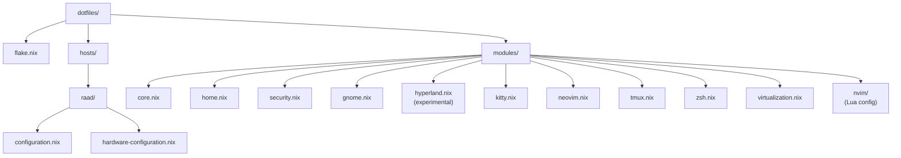

My laptop is called `raad` (رعد in Arabic). It runs NixOS, configured
through a single flake that lives at
[github.com/0xSA7/dotfiles](https://github.com/0xSA7/dotfiles). This
post walks through the architecture of that flake, why I picked NixOS
in the first place, and a small trick that lets me reuse the same
modules on Ubuntu when I need to test snapcraft builds.

I chose NixOS for three reasons: declarative configuration,
reproducibility, and rollback. Once the system is described in Nix,
I can rebuild it from a fresh install with one command. If an upgrade
breaks something, I reboot into the previous generation from the
GRUB menu and the system is exactly as it was. For a security engineer
who tweaks kernel params, secure boot, and systemd services on a
weekly basis, that safety net is non-negotiable.

## The flake architecture

The whole system is defined in `flake.nix`:

```nix
{
  description = "Raad System Flake";
  inputs = {
    nixpkgs.url = "github:nixos/nixpkgs/nixos-26.05";
    unstable.url = "github:nixos/nixpkgs/nixos-unstable";
    home-manager = {
      url = "github:nix-community/home-manager/release-26.05";
      inputs.nixpkgs.follows = "nixpkgs";
    };
    lanzaboote = {
      url = "github:nix-community/lanzaboote";
      inputs.nixpkgs.follows = "nixpkgs";
    };
  };
  outputs = { self, nixpkgs, home-manager, unstable, lanzaboote, ... }@inputs:
  let
    system = "x86_64-linux";
    unstablePkgs = import unstable {
      inherit system;
      config.allowUnfree = true;
      config.android_sdk.accept_license = true;
    };
  in {
    nixosConfigurations = {
      raad = nixpkgs.lib.nixosSystem {
        inherit system;
        specialArgs = { inherit unstablePkgs; };
        modules = [
          ./hosts/raad/configuration.nix
          lanzaboote.nixosModules.lanzaboote
          home-manager.nixosModules.home-manager
          {
            home-manager.useGlobalPkgs = true;
            home-manager.useUserPackages = true;
            home-manager.extraSpecialArgs = { inherit unstablePkgs; };
            home-manager.users.sa7 = import ./modules/home.nix;
          }
        ];
      };
    };
  };
}
```

Two things are worth pointing out.

First, **dual-channel inputs**. The system tracks `nixos-26.05`
(stable) as the default and `nixos-unstable` as a secondary input.
`unstablePkgs` is constructed in the `let` binding and threaded
through `specialArgs` so that any module can pull a package from
unstable by referring to `unstablePkgs.foo` instead of `pkgs.foo`.
This lets me run a bleeding-edge version of one tool without dragging
the rest of the system onto unstable.

Second, **`inputs.nixpkgs.follows = "nixpkgs"`** on every dependent
flake (home-manager, lanzaboote). Without that, each dependent would
pull its own copy of nixpkgs, and the closure would balloon by
hundreds of megabytes. The `follows` directive pins them to the same
nixpkgs revision, which keeps the store lean and the eval fast.

## The modules/hosts split

The repo is split into two top-level directories:



`hosts/raad/` holds the host-specific bits: hostname, NVIDIA bus IDs,
secure boot paths, hardware scan. Everything else lives under
`modules/`. The host imports the modules it needs and adds the
host-specific glue on top:

```nix
# hosts/raad/configuration.nix
{ config, pkgs, lib, ... }:
{
  imports = [
    ./hardware-configuration.nix
    ../../modules/core.nix
    ../../modules/virtualization.nix
  ];
  networking.hostName = "raad";
  # host-specific boot, NVIDIA, secure boot config follows
}
```

The split paid off the moment I needed to add a second host. Nothing
in `modules/` references `raad` by name. A new host just drops a
new folder under `hosts/`, imports the modules it wants, and overrides
the host-specific values. I have not added a second host yet, but the
cost of doing so is now bounded.

## Security: kernel hardening and secure boot

`modules/security.nix` is the part that is specific to my work. It
sets the kernel parameters I want on any machine I do security work on:

```nix
{ config, pkgs, ... }:
{
  boot.kernelParams = [
    "slab_nomerge"
    "slub_debug=FZ"
    "page_alloc.shuffle=1"
    "vsyscall=none"
  ];
  security.protectKernelImage = true;
  security.forcePageTableIsolation = true;
}
```

Each parameter closes a specific attack surface:

- `slab_nomerge` keeps slab caches separate, which makes heap
  spraying harder and makes exploitation less reliable.
- `slub_debug=FZ` enables freelist poisoning detection (`F`) and
  red zoning (`Z`), which catches more heap corruption bugs at
  runtime.
- `page_alloc.shuffle=1` randomizes the page allocator, which
  makes physical-to-virtual page prediction attacks harder.
- `vsyscall=none` disables the legacy vsyscall page, which has
  been a known ROP gadget source for years.

On top of that, the host enables
[lanzaboote](https://github.com/nix-community/lanzaboote) for
[UEFI Secure Boot](https://learn.microsoft.com/windows-hardware/design/device-experiences/oem-secure-boot).
Lanzaboote signs UKIs (Unified Kernel Images) with a key enrolled in
the firmware, so the boot chain is verifiable from the firmware all
the way to the kernel command line:

```nix
boot.loader.grub.enable = lib.mkForce false;
boot.loader.systemd-boot.enable = lib.mkForce false;
boot.lanzaboote = {
  enable = true;
  pkiBundle = "/etc/secureboot";
};
```

The `mkForce false` on the legacy bootloaders is necessary because
the default NixOS install pulls in `systemd-boot`, and lanzaboote
needs to replace it rather than coexist with it.

There is also a template for a sandboxed systemd service in the same
file. The pattern is what I copy-paste whenever I need to run
something in a strict sandbox:

```nix
systemd.services.isolated-vault = {
  description = "Example Sandboxed Service";
  wantedBy = [ "multi-user.target" ];
  serviceConfig = {
    ExecStart = "${pkgs.coreutils}/bin/sleep infinity";
    ProtectSystem = "strict";
    ProtectHome = true;
    PrivateTmp = true;
    NoNewPrivileges = true;
    PrivateDevices = true;
    MemoryDenyWriteExecute = true;
    RestrictRealtime = true;
  };
};
```

`MemoryDenyWriteExecute = true` is the one most people forget. It
blocks `mmap` with `PROT_WRITE | PROT_EXEC`, which kills JIT spray
and shellcode-in-jitregion attacks dead. Anything that needs a JIT
(CLR, V8, JVM) will refuse to start under this setting, which is a
feature, not a bug, when you are running untrusted code.

## Hardware: NVIDIA Optimus

`raad` is a laptop with Intel integrated graphics and an NVIDIA
dGPU. I run them in sync mode:

```nix
hardware.nvidia = {
  prime = {
    sync.enable = true;
    intelBusId = "PCI:0:2:0";
    nvidiaBusId = "PCI:1:0:0";
  };
  modesetting.enable = true;
  powerManagement.enable = true;
  open = false;
  nvidiaSettings = true;
};
```

I picked `sync.enable = true` rather than PRIME offload for two
reasons. First, sync mode is more predictable: every window uses the
dGPU, so I do not have to remember to mark specific apps as
NVIDIA-rendered. Second, the open-source NVIDIA driver (`open = true`)
does not yet support my GPU generation, so I am on the proprietary
blob for now. PRIME offload has historically been flakier with the
proprietary driver.

The kernel params in `hosts/raad/configuration.nix` are tuned for
this setup:

```nix
boot.kernelParams = [
  "nvidia-drm.modeset=1"
  "nvidia.NVreg_PreserveVideoMemoryAllocations=1"
  "nvidia.NVreg_TemporaryFilePath=/var/temp"
  "nvme_core.default_ps_max_latency_us=0"
  "pcie_aspm=off"
];
```

`NVreg_PreserveVideoMemoryAllocations=1` is necessary to survive
suspend/resume without the GPU falling off the bus. The NVMe and
ASPM params are power-management tweaks I copied from a Phoronix
article a year ago and have not revisited since.

## The portable home-manager trick

I do security work on Ubuntu VMs as well, mostly because snapcraft
builds are not supported on NixOS. I still want the same shell,
terminal, editor, and multiplexer as on `raad`, so I added
`modules/ubuntu-dev-home.nix`:

```nix
{ config, pkgs, unstablePkgs, lib, ... }:
{
  imports = [
    ./kitty.nix
    ./neovim.nix
    ./tmux.nix
    ./zsh.nix
  ];

  home.packages = with pkgs; [
    git
    fzf
    ripgrep
    imagemagick
    ueberzugpp
  ];

  programs.home-manager.enable = true;
}
```

This module imports the exact same `kitty.nix`, `neovim.nix`,
`tmux.nix`, and `zsh.nix` that `raad` uses. On Ubuntu I install
home-manager in standalone mode, point it at this module, and run
`home-manager switch`. My kitty config, my neovim keybindings, my
zsh aliases, and my tmux setup land on the Ubuntu machine exactly as
they are on `raad`.

The trick is that nothing inside `modules/kitty.nix`,
`modules/neovim.nix`, `modules/tmux.nix`, or `modules/zsh.nix`
references anything NixOS-specific. They are pure home-manager
modules, so they work the same whether they are pulled in by a
NixOS module (on `raad`) or by standalone home-manager (on Ubuntu).

The trade-off is real, though. On Ubuntu I do not get the kernel
hardening, the secure boot chain, or the systemd sandboxing. Those
require system-level configuration, and on Ubuntu the system is not
managed by Nix. The portable modules cover the user-level dev
environment only. For anything that touches `/etc`, I am back on
apt and `systemctl edit`.

## Auto-commits

The repo has an auto-commit entry dated 2026-06-27 that was pushed
by a small shell utility I wrote called
[auto-git](https://0xsa7.github.io/0xSA7/blog/auto-git-shell-script-commit-laziness/).
It stages and commits dotfiles on a schedule so I do not lose changes
between real commits. I have written about it separately, but the
short version is: every dotfiles repo should have one, because the
alternative is finding out three weeks later that the alias you added
never made it to git.

## What I took from it

Three things stayed with me.

First, the value of NixOS is rollback, not declarativity. Declarative
config is nice, but the moment you actually need it is when an
upgrade breaks secure boot at 2 AM. The fact that GRUB still lists
the previous generation as a boot entry has saved me twice.

Second, the modules/hosts split is not about future-proofing for
"multiple hosts someday". It is about being able to test changes
on a VM with a stripped-down config without touching the real host.
Even with one host, the split is worth it.

Third, the portable home-manager trick reframed how I think about
dotfiles. The system-level config and the user-level config are two
different problems. NixOS is the right answer to the first.
home-manager, run standalone, is a perfectly good answer to the
second, even on non-NixOS machines. Splitting them lets each tool do
what it is good at.

The repo is on [GitHub](https://github.com/0xSA7/dotfiles). The
history is small enough to read in one sitting.
