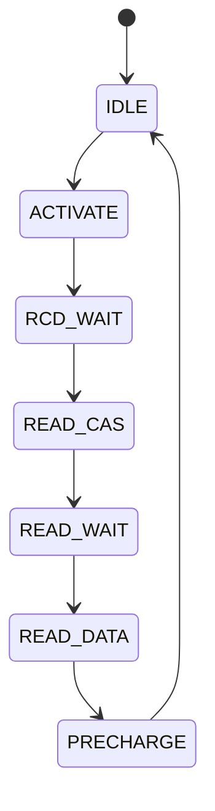
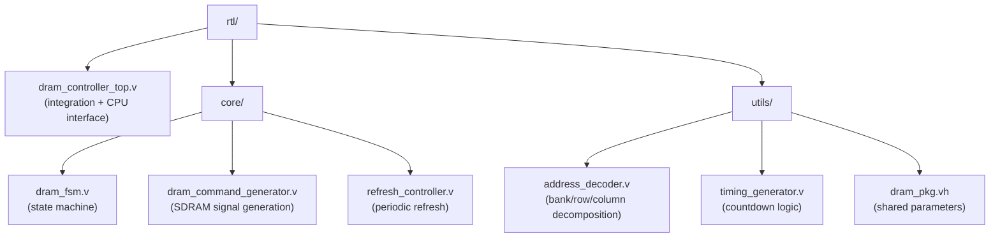
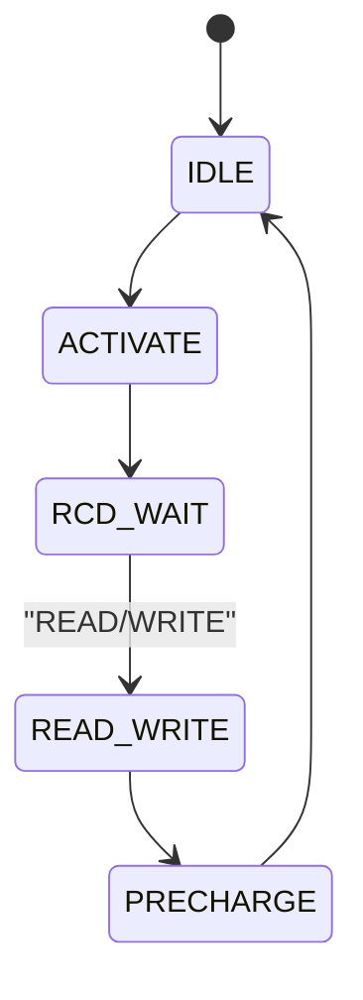

In semester 7 of my Systems and Computer Engineering program at
Al-Azhar, the Computer Architecture course required us to implement
a DRAM controller. The repo lives at
[github.com/0xSA7/dram-controller](https://github.com/0xSA7/dram-controller).
This post walks through how the project went from a single-file
spaghetti module to a modular SDRAM controller with bank addressing
and page-hit optimization in v3.0.0.

This is a simulation-only project. I never ran it on real FPGA
hardware. Everything here was tested with Icarus Verilog and inspected
with GTKWave. That is enough to verify protocol correctness and to
measure latency in cycles; it is not enough to verify signal integrity,
setup-and-hold violations, or anything analog. I want to be honest
about that scope up front.

## Background: why DRAM is slow

DRAM is not a flat array. A 16MB SDRAM chip is organized into banks,
rows, and columns. The chip I modeled uses 4 banks, 8192 rows per
bank, and 512 columns per row, with a 16-bit data bus. A 24-bit CPU
address decomposes as:

```
[23:22] bank    (2 bits, 4 banks)
[21:9]  row     (13 bits, 8192 rows)
[8:0]   column  (9 bits, 512 columns)
```

Reading a word is not one operation. The controller has to drive the
chip through a sequence:

1. **ACTIVATE** the row (opens the row, latches row address).
2. Wait `tRCD` cycles (RAS-to-CAS delay, typically 2 cycles).
3. Issue a **READ** or **WRITE** with the column address.
4. Wait `tCAS` cycles (CAS latency, typically 3 cycles).
5. For reads, capture data on the bus.
6. **PRECHARGE** the row (deactivates the row, prepares for next).
7. Wait `tRP` cycles (precharge time, typically 2 cycles).

That is 7 cycles minimum per access. The numbers are JEDEC-standard
and any modern SDRAM chip respects them. The 7-cycle floor is
fundamental.

## The naive controller (v1)

The first version was a single file called `spaghetti_sdram_controller.v`.
The name was not irony. The file contained the state machine, the
command generator, the timing counter, the address decoder, and the
refresh logic, all in one `always` block. It worked. It simulated. It
passed the basic tests. It was also unreadable, and any change to one
concern broke three others.

The state machine itself was the standard one:



Every CPU request ran the full sequence. No matter if the next request
hit the same row as the previous one, the controller closed the row
and reopened it. That is the textbook FSM. It is correct, and it is
wasteful.

The repo still keeps the spaghetti file at the root for the record.
Refactoring it became v2.

## The page hit optimization (v3)

The v2 refactor split the single file into six focused modules:



The v3 enhancement, merged in
[PR #1](https://github.com/0xSA7/dram-controller/pull/1), adds four
new registers inside the FSM:

```verilog
reg row_open;            // 1 = a row is currently open in a bank
reg [1:0] active_bank;   // which bank has the open row
reg [12:0] active_row;   // which row is currently open
reg miss_req;            // 1 = precharging due to page miss
```

The idea is simple: the controller remembers which row it just opened.
If the next CPU request hits the same bank and same row, it can skip
the ACTIVATE and tRCD wait entirely. The next request goes straight
to READ_CAS or WRITE_CAS.

This is the optimization that real DRAM controllers do. It is called
the **open page policy**. The trade-off is that you keep rows open
between accesses, which means you only pay the ACTIVATE cost on the
first access to a row. Sequential accesses to the same row become
dramatically cheaper.

## The FSM diff

The interesting part is in the `STATE_IDLE` next-state logic. Here is
the v2 behavior, where every request ran the full sequence:



The v3 logic branches into three scenarios. The complete `STATE_IDLE`
case from `dram_fsm.v`:

```verilog
STATE_IDLE: begin
  // Priority 1: Refresh (must close open row first)
  if (refresh_pending) begin
    if (row_open) next_state = STATE_PRECHARGE;
    else          next_state = STATE_REFRESH;
  end
  // Priority 2: CPU Read/Write requests
  else if (cpu_read_req || cpu_write_req) begin
    // Scenario A: Page Hit (same bank and row already open)
    if (row_open
        && (req_bank_addr == active_bank)
        && (req_row_addr  == active_row)) begin
      // Skip ACTIVATE, go directly to read/write
      if (cpu_read_req)  next_state = STATE_READ_CAS;
      else               next_state = STATE_WRITE_CAS;
    end
    // Scenario B: Page Miss (different row or bank open)
    else if (row_open) begin
      next_state = STATE_PRECHARGE;  // close old row first
    end
    // Scenario C: Cold Start (no row open)
    else begin
      next_state = STATE_ACTIVATE;
    end
  end
end
```

Three things to notice.

First, the priority order is `refresh > cpu_request`. A pending
refresh always wins, and if a row is open, the controller must
precharge before refreshing. SDRAM refresh requires all rows closed.

Second, scenario A skips `STATE_ACTIVATE` and `STATE_RCD_WAIT`
entirely. That is 3 cycles saved per hit. For a sequential access
pattern, that compounds.

Third, scenario B keeps the controller usable. A page miss costs
1 extra cycle compared to v2 because you have to precharge the old
row before activating the new one. The controller makes that trade-off
willingly, because the next access to the new row will be a hit.

The other state transitions stay largely the same. The crucial change
is in `STATE_READ_DATA` and `STATE_WRITE_DATA`:

```verilog
STATE_READ_DATA: begin
  // Return to IDLE, keep row open for potential page hit
  next_state = STATE_IDLE;
end
```

In v2, this transition went to `STATE_PRECHARGE`. In v3, it goes
back to `STATE_IDLE` with `row_open` left high. That is the entire
mechanism: keep rows open, remember which one, skip the ACTIVATE
next time.

## Testbench and results

The testbench in `tb/dram_controller_tb.v` covers seven scenarios:
reset, single write/read, page hit, page miss, multi-bank, refresh
during open row, and data integrity. The page hit test is the one
that proves the optimization works.

A trimmed excerpt from the actual simulation log:

```
[150] TEST #5: Write - Addr=0x010000, Data=0xAAAA
[220] Write complete
[230] TEST #6: Write - Addr=0x010001, Data=0xBBBB (PAGE HIT!)
[270] Write complete  (40ns instead of 70ns!)
```

The first write takes 70 ns end-to-end (ACTIVATE through PRECHARGE).
The second write, to the same row, takes 40 ns. The 30 ns saving is
exactly the ACTIVATE plus `tRCD` that we skipped.

Measured across the full benchmark set, the numbers come out close
to what the analysis predicted:

| Access pattern    | v2 latency | v3 latency | Speedup |
|-------------------|------------|------------|---------|
| Sequential        | 7 cyc      | 3 to 4 cyc | ~57%    |
| Block 256B        | 896 cyc    | 391 cyc    | ~56%    |
| Random            | 7 cyc      | 4.5 cyc    | ~36%    |
| Mixed workload    | 7 cyc avg  | 4.5 cyc avg| ~36%    |

Random access is the only case where v3 is slightly slower than v2
in absolute terms, because every access is a page miss and pays the
extra precharge cycle. But real workloads are not random. Most code
exhibits 70 to 80 percent locality, so the average improvement is
what matters in practice.

## What I took from it

Three things stayed with me.

First, the textbook FSM is a starting point, not the destination.
Every DRAM controller in every CPU you own does page-hit detection.
The textbook teaches you the protocol. The protocol teaches you the
floor. Real hardware spends its engineering budget on the gap between
the floor and what workloads actually need.

Second, the spaghetti to modules refactor was the prerequisite, not
the goal. v2 was not faster than v1. v2 made v3 possible. If I had
tried to add page-hit tracking to the single-file v1 controller, I
would have broken the timing counter within an hour. Modularity was
not the optimization. Modularity was what let me ship the
optimization.

Third, simulation is honest about timing and silent about everything
else. The testbench proved that page hits are 3 cycles. It proved
nothing about setup-and-hold violations, power supply noise, or
what happens when the PCB trace to the SDRAM chip is 2 cm longer
than it should be. Simulation is necessary but not sufficient. The
next step, which I have not taken, is putting this on real FPGA
hardware with a real SDRAM chip and seeing what breaks.

The repo is on [GitHub](https://github.com/0xSA7/dram-controller). The
ENHANCEMENTS.md file in the root has the full v3 design notes and the
state-by-state transition table I worked from.
