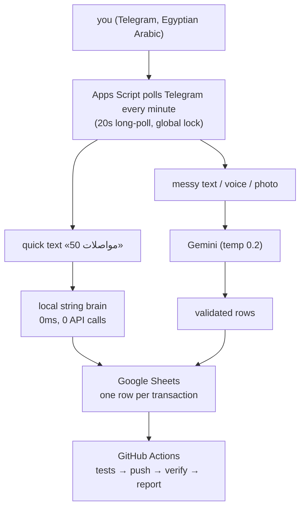

It started at a supermarket checkout. I was standing there doing what
everyone does: looking at the total and quietly rounding it down in my
head. "It's basically 200." It was 265, and I had done this exact thing
maybe four times that week. The notebook I'd started for tracking
expenses had died on day three.

Every expense app I tried failed for the same reason: they wanted me to
fill forms. Pick a category from a dropdown. My brain, standing at that
checkout, doesn't speak dropdowns. It speaks Egyptian Arabic, in the exact
words I'd say out loud: «صرفت ٦٥ مواصلات». I wanted to just say that to
someone and have it accounted for.

So I built that someone. Her name is المحفظة ("the wallet" in Egyptian
Arabic), and she lives in my Telegram chat, which is where my thumb
already is. The repo is at
[github.com/0xSA7/elm7fza_bot](https://github.com/0xSA7/elm7fza_bot).

## The stack

I had three hard requirements and zero budget:

- **It must live where I already am.** Not an app I open, but a chat I
  already have open. The interface is a text box, and the language is
  whatever I type at 2am.
- **It must cost $0.** Google Apps Script gives you triggers, UrlFetchApp
  and LockService inside free personal quotas. A 1-minute trigger doing
  20-second long polls is effectively real-time for a human.
- **The data must be mine, visibly.** A plain Google Sheet, one row per
  transaction, with my original message text in a column. The day I stop
  trusting the bot, I can read the ledger like a book. There's no export
  button because the storage is the export.

The first version was a weekend of regex. «50 مواصلات» parsed fine. Then
reality arrived: «اتغدت انا وصاحبي ودفعت ٣٥٠ وبعدين شريت سجاير ٨٠» is not
a regex problem. Arabic numerals flip direction mid-sentence, Franco-Arabic
shows up, and there are three amounts in one breath. That's when Gemini
joined, and the architecture split into two brains: a local one that
answers instantly for the 80% case (shortcuts like اكل، مواصلات، كهربا map
straight to categories), and the AI one for everything messy. Temperature
is 0.2, because for money I want the AI as predictable as possible.

Here is how a message flows:



## What production taught me

The features were the easy part. Three incidents in production taught me
more, and each one became a version.

**v37, the double charge.** One day Gemini was slow, a poll cycle took
minutes, and the next cycle started before the first one finished and
fetched the same message again. Nothing crashed, but it saved the same
expense twice, silently, and my `/today` was wrong. A finance bot that is
sometimes wrong isn't useful. The fix was a global script lock (one poll
cycle at a time, ever), offset acknowledgement *before* processing (a crash
mid-message can never re-fetch it), and dedup on update ids. Four layers
now stand between "Telegram retried a message" and "my totals are wrong."

**v39, the message that vanished.** Apps Script executions get killed at
around six minutes. One evening Gemini hung, the execution died mid-call,
and my message disappeared. No error, no save, no reply. The rule I took
from it: never lose user input, even if the script dies. Now, *before* any
AI call, the message gets a reservation row in a retry sheet. If the
execution dies, the next cycle finds the reservation and retries, for up
to 12 hours, with an honest «السيرفرات عليها ضغط، هحاول تلقائياً» message.
This is write-ahead logging, an old database technique, applied to a chat
bot.

**v40, me, wrong at the source.** I sent «كشف امي ٢٠٠» when it was ٦٠٠.
Fixing it by hand in the Sheet would mean quietly editing the ledger I
trust, so I built a correction flow instead. Reply to your own old message
and type «كشف امي كان ب ٦٠٠ مش ٢٠٠». The bot finds the rows by message id,
deletes them, writes the corrected one, and tells you what changed. Reply
with «امسح» and the row is deleted and the money returns to your totals,
because totals are never cached. They're computed from the sheet, so
deleting a row *is* a refund.

Always recomputing totals from the source is the decision I'd defend in
any design review. The bot keeps no beliefs about your money beyond the
sheet, and it looks at the sheet every single time.

## The feature I didn't plan

One month I did the math on how long my money had to last, and it worried
me. So المحفظة got a runway: «/runway 2026-11-05 2026-11-30», and from
then on every save answers with one extra line:

```
✈️ باقي 10,175 · سماحك 363 ج/يوم لحد 11-30 🔴
```

It shows what's left, what you're allowed per day, until when, and a color
that means "today you're over your own pace." It answers the question I
used to dodge at the checkout, every day. A footnote: v40's version of that
line also repeated my income on every message, and I got annoyed by my own
feature within 48 hours. v41 toned it down.

## The week a ghost contributed to my private repo

This one is worth telling. My repo is private, and its Contributors panel
suddenly showed two accounts: me, and a stranger called `sa7`. I did not
take it calmly. The explanation was that my patch emails used
`SA7@users.noreply.github.com`, GitHub's *old* noreply format, which GitHub
resolves by username, and `sa7` happens to be a dormant account that isn't
me. It had no access and no permissions, just my commit emails wearing its
name. I fixed it with a history rewrite: all 25 commits re-authored to my
real identity, force-pushed, ghost gone. The cause was boring, and the
real list of who has access was in the repo Settings the whole time: just
me.

## Testing and deploy

Apps Script has no local runtime, so there is no "run the tests" button. I
built a Node `vm` sandbox that imitates the platform: a fake SpreadsheetApp
that really stores rows, a fake LockService, fake Telegram responses. 78
tests now run in under two seconds on my laptop, and the same suite gates
the deploy: a red test means no push and no ship. There's also a guard test
that reads every file in the repo and fails if it finds an em dash, because
v41 removed them from the bot's replies and I wanted that to be a rule, not
a mood. (My bot banned em dashes before I did.)

Deploy is one command, `./deploy.sh "what changed"`. It bumps the version,
commits, pushes, and lets GitHub Actions do the real work: run the tests
again (CI trusts no laptop), swap the project onto Google with a full
content PUT, pull it back and byte-compare every file, check that the bot
is alive, and message me on Telegram with the verdict. If anything is red,
I get the 🚨 message and production keeps running the old version. The repo
and production never quietly disagree.

## The numbers

| | |
| --- | --- |
| Current version | v41 (v30 was the baseline) |
| Source files | 16 JavaScript files, plus the Apps Script manifest |
| Tests | 78, all green, ~2 seconds |
| Monthly cost | $0 (personal quotas) |
| Latency, quick text | instant, zero AI calls |
| Latency, AI path | 2-5s, up to 12h retry when Gemini is slammed |
| Uptime since v39 | has not lost a message yet |

## What it changed

A bot doesn't rewrite your finances. It removed the one friction that
killed every earlier attempt: the gap between spending and recording. That
gap is only a few seconds long, but it's where my budgets used to die. Now
I send a message without stopping, in the language I think in, and the bot
does the accounting.

Lying to myself got harder too. I still round down at the checkout, but at
23:30 every night المحفظة sends the digest: income, spending, whether I'm
on pace, tomorrow's allowance. She never rounds anything down. I recommend
building one.

If you want your own, I wrote the full documentation, from setup to
architecture to security, in the
[repo's docs folder](https://github.com/0xSA7/elm7fza_bot/tree/main/docs),
covering everything from BotFather to your first «50 مواصلات». It takes
about an hour. The bot you build will only answer you (one chat id, hard
gate), keep its books in your Sheet, and cost nothing a month. Bring your
own dialect.