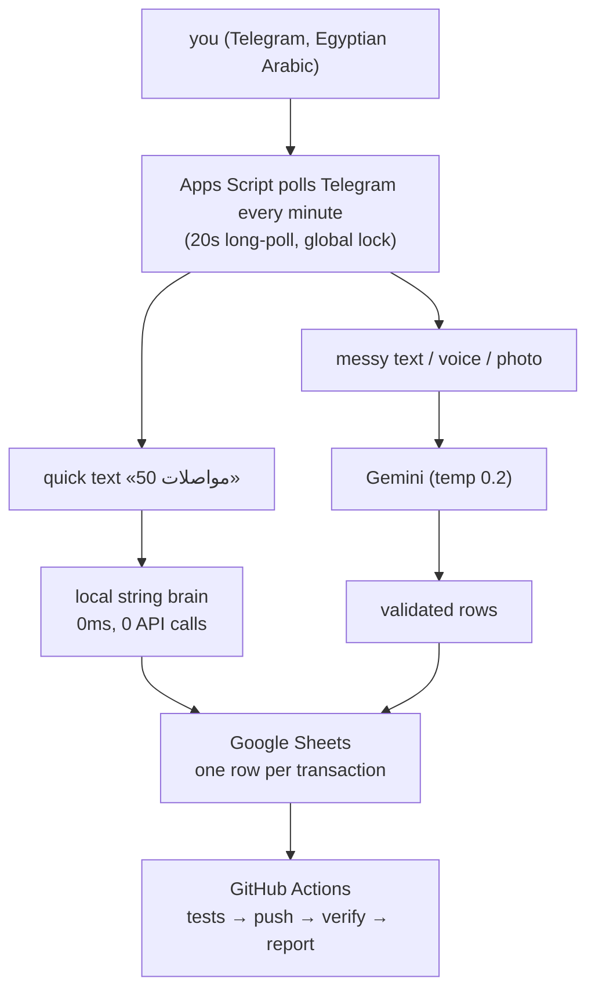

It started at a supermarket checkout. I was standing there doing the thing
everyone does: looking at the total and quietly rounding it down in my head.
"It's basically 200." It was not basically 200. It was 265, and I had done
this exact maneuver maybe four times that week, and the notebook I'd started
tracking expenses in had died on day three, because notebooks require you
to be a different person than you are.

Every expense app I tried failed for the same reason: they wanted me to fill
forms. Pick a category from a dropdown. And my brain, standing at that
checkout, does not speak dropdowns. It speaks Egyptian Arabic, in the exact
words I'd say out loud: «صرفت ٦٥ مواصلات». I wanted to just... say that.
To someone. And have it be accounted for.

So I built the someone. Her name is المحفظة ("the wallet" in Egyptian
Arabic), and she lives in my Telegram chat, which is where my thumb already
lives. The repo is at
[github.com/0xSA7/elm7fza_bot](https://github.com/0xSA7/elm7fza_bot).

## The stack, chosen by laziness (the good kind)

I had three hard requirements and zero budget:



- **It must live where I already am.** Not an app I open. A chat I already
  have open. The interface is a text box, and the interface language is
  whatever I type at 2am.
- **It must cost $0.** Google Apps Script gives you triggers, UrlFetchApp
  and LockService inside free personal quotas. A 1-minute trigger doing
  20-second long polls is effectively real-time for human purposes.
- **The data must be mine, visibly.** A plain Google Sheet. One row per
  transaction, with my original message text sitting right there in a
  column. The day I stop trusting the bot, I can read the ledger like a
  book. No export button in sight because the "export" is the storage.

The first version was a weekend of regex. «50 مواصلات» parsed fine.
Then reality arrived: «اتغدت انا وصاحبي ودفعت ٣٥٠ وبعدين شريت سجاير ٨٠» is
not a regex. Arabic numerals that flip direction mid-sentence, Franco-Arabic
mixing, three amounts in one breath. That's when Gemini joined, and the
architecture split into two brains: a local one that answers instantly for
the 80% case (shortcuts like اكل، مواصلات، كهربا map straight to
categories), and the AI one for everything messy. Temperature 0.2, because
money is the one place where I want my AI to be the most boring person
alive.

## Then production taught me the real syllabus

The features were the easy part. The bot's actual education came from three
incidents, and each one became a version number and a scar.

**v37, the double charge.** One day Gemini was slow, a poll cycle took
minutes, and the next cycle started before the first finished and fetched
the same message again. Nothing crashed. It was worse: it *saved the same
expense twice*, silently, and my `/today` was wrong. A finance bot that is
sometimes wrong is worthless, it's just a spreadsheet with extra steps. The
fix was a global script lock (one poll cycle at a time, ever), plus offset
acknowledgement *before* processing (crash mid-message can never re-fetch
it), plus dedup on update ids. Four layers now stand between "Telegram
retried a message" and "my totals are wrong."

**v39, the message that vanished.** Apps Script executions get guillotined
at around six minutes. One evening Gemini hung, the execution died
mid-call, and my message just... ceased. No error, no save, no reply. The
lesson: never lose user input, even if you die. Now, *before* any AI call,
the message gets a reservation row written to a retry sheet. If the
execution dies, the next cycle finds the reservation and retries. For up
to 12 hours, with an honest «السيرفرات عليها ضغط، هحاول تلقائياً» message.
Write-ahead logging, the oldest trick in databases, applied to a chat bot,
because a chat bot is a database with a personality.

**v40, me, wrong at the source.** I sent «كشف امي ٢٠٠» when it was ٦٠٠.
Old me would open the Sheet, find the row, fix it by hand, and quietly
corrupt my trust in everything else. Instead: reply to your own old message
and type the correction. «كشف امي كان ب ٦٠٠ مش ٢٠٠». The bot finds the rows
by message id, deletes them, writes the corrected one, and tells you what
changed. Reply with «امسح» and it's deleted and the money returns to your
totals, because the totals were never cached: they're computed from the
sheet, so deleting a row *is* a refund.

That last design decision, totals always recomputed from source, is the
one I'd defend in front of a committee. The bot doesn't have beliefs about
your money. It has the sheet, and it looks, every single time.

## The runaway feature

The one feature I didn't plan became the one I use most. One month I did
the math on how long my money had to last and felt that specific cold
feeling. So المحفظة got a runway: «/runway 2026-11-05 2026-11-30», and from
that moment every single save answers with one extra line:

```
✈️ باقي 10,175 · سماحك 363 ج/يوم لحد 11-30 🔴
```

What's left, what you're allowed per day, how long, and a color that means
"today you're over your own pace." It's the checkout moment, resolved in
real time, every day. Amusing footnote: v40's version of that line also
repeated my income every single message, and I built it, shipped it, and got
annoyed by my own feature within 48 hours. v41 made it calm. Ship fast,
apologize to yourself faster.

## The week a ghost contributed to my private repo

This deserves its own paragraph because it's the most "git is a social
construct" story I own. My repo is private, and its Contributors panel
suddenly showed two accounts: me, and a stranger called `sa7`. My first
thoughts were not calm. The actual explanation: my patch emails used
`SA7@users.noreply.github.com`, which is GitHub's *old* noreply format,
which GitHub resolves by username, and `sa7` happens to be some dormant
account that isn't me. No access, no permissions, just commit emails
wearing someone else's coat. Fixed with a history rewrite, all 25 commits
re-authored to my real identity, force-pushed, ghost gone. The scary
sounding thing had a boring cause, which is how most scary sounding things
end, and the audit trail (who *actually* has access) was in repo Settings
all along, where it had always said: just me.

## The boring parts are the ones I'm proudest of

The fun part nobody warns you about: Apps Script has no local runtime, so
"run the tests" is not a button that exists. The answer was a Node `vm`
sandbox impersonating the entire platform: fake SpreadsheetApp that really
stores rows, fake LockService, fake Telegram responses. 78 tests now run in
under two seconds on my laptop, and the same suite gates the deploy: red
test equals no push equals no ship. There's even a silly guard test that
reads every file in the repo and fails if it finds a single em dash,
because v41 removed them all from the bot's personality, and I wanted that
decision to be permanent law, not a mood. (Yes, my bot banned em dashes
before I did. We grow in the directions we push each other.)

Deploy is one command, `./deploy.sh "what changed"`, which bumps the
version, commits, pushes, and lets GitHub Actions do the real work: run
the tests again (CI trusts no laptop), swap the project onto Google with a
full content PUT, then *pull it back and byte-compare every file*, then
check the bot is alive, then message me on Telegram with the verdict. If
anything is red, I get the 🚨 message and production is still running the
old version. The repo and production are never allowed to quietly disagree.

## The numbers

| | |
| --- | --- |
| Versions shipped | 41 (v30 baseline to v41) |
| Source files | 16 JavaScript files, ~1 GAS manifest |
| Tests | 78, all green, ~2 seconds |
| Monthly cost | $0 (personal quotas) |
| Latency, quick text | instant, zero AI calls |
| Latency, AI path | 2-5s, up to 12h retry when Gemini is slammed |
| Uptime since v39 | has not lost a message yet |

## What it actually changed

I won't pretend a bot rewrites your finances. What it did was remove the one
friction that killed every previous attempt: the moment between spending and
recording. That moment is where budgets go to die, because it's three seconds
long and full of excuses. Now it's a message I send without breaking stride,
in the language I think in, and the accounting happens to someone else.

And the lying got harder. The checkout rounding still happens, I'm human.
But at 23:30 every night المحفظة sends the digest, income, spending, whether
I'm on pace, tomorrow's allowance, and it never rounds anything down. A
machine that only ever tells you the truth about your own numbers is a
strange kind of friend. I recommend building one.

If you want your own, I wrote the full documentation, setup to architecture
to security, in the [repo's docs folder](https://github.com/0xSA7/elm7fza_bot/tree/main/docs):
everything from BotFather to your first «50 مواصلات». It takes about an
hour. The bot you build will only answer you (one chat id, hard gate), keep
its books in your Sheet, and cost nothing a month. Bring your own dialect.
